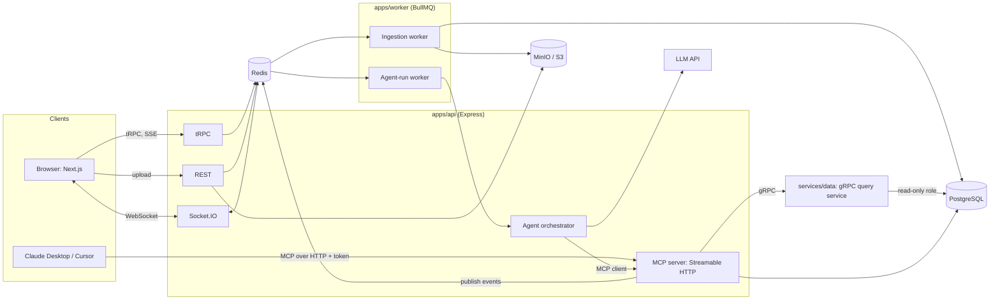

# Architecture: Graphite

## 1. Overview

Graphite is a monorepo of a Next.js frontend, an Express API (tRPC, REST, WebSockets, agent orchestration), BullMQ workers, and a gRPC data service. PostgreSQL stores application data and uploaded datasets. Redis backs queues, pub/sub, presence, and rate limits. The agent's tools live in an MCP server that both Graphite's own agent and external clients use.

## 2. System diagram



## 3. Components

### 3.1 apps/web (Next.js)
- App Router; server components for shells and public shared dashboards; client components for the editor.
- **Canvas**: react-grid-layout or dnd-kit for positions and sizes; Framer Motion `layout` animations for swaps and reflow.
- **Charts**: ECharts renders a `ChartSpec` through a single `specToEChartsOption()` adapter.
- **State**: TanStack Query for server state (via tRPC), Zustand for editor-local state (selection, layout draft, presence).
- **Agent panel**: `useChat` and SSE show streamed text, tool-call steps, and cancel controls.
- **Collaboration**: Socket.IO client joins a dashboard room, sends cursor/layout events, and receives remote updates.

### 3.2 apps/api (Express)
- **tRPC**: all browser-facing typed calls (CRUD, queries, mutations).
- **REST**: file upload, SSE streams, public share endpoints, MCP HTTP endpoint, OAuth endpoints, health and metrics.
- **Socket.IO** with the Redis adapter, so users on different instances share rooms.
- **Orchestrator**: builds prompts, runs the AI SDK tool loop, writes steps to Postgres, publishes run events to Redis.
- **Auth middleware**: resolves session or token into `{ userId, orgId, role }` for every request.

### 3.3 apps/worker (BullMQ)
| Queue | Purpose | Notes |
|---|---|---|
| `ingestion` | Parse CSV, infer types, load into dataset table | Streaming parse, batched inserts, progress events |
| `agent-run` | Execute an agent run | Concurrency-limited, cancellable, token budget |
| `maintenance` | Cleanup, expired tokens, stale runs | Repeatable jobs |

All jobs are idempotent (keyed by dataset ID or run ID) and use exponential backoff with a dead-letter policy.

### 3.4 services/data (gRPC)
Owns all execution of user-visible SQL.
- Connects as `graphite_readonly`, which has SELECT only on the `datasets` schema.
- Enforces `statement_timeout`, a row limit, and an allowlist of tables per request (the caller passes dataset IDs).
- Parses SQL (AST check) to reject anything but a single SELECT.
- Methods: `DescribeDataset`, `RunQuery`, `SampleRows`, `ColumnStats`.

### 3.5 packages/mcp-server
Defines tools and resources once with the MCP TypeScript SDK and Zod schemas.
- **Internal use**: the orchestrator connects with the AI SDK's MCP client.
- **External use**: mounted at `/mcp` over Streamable HTTP; authenticated by personal access token (OAuth 2.1 later).
- Every tool call executes with the caller's identity, so role and tenant checks are identical for internal and external callers.

### 3.6 packages/chart-spec
Zod schemas and TypeScript types shared by frontend, API, MCP server, and agent. This package is the contract that keeps AI output safe to render.

## 4. Key design: declarative chart specs

The agent never writes chart code. It emits a `ChartSpec`:

```json
{
  "version": 1,
  "type": "bar",
  "title": "Revenue by region",
  "datasetId": "ds_123",
  "query": {
    "select": [
      { "field": "region", "as": "region" },
      { "agg": "sum", "field": "revenue", "as": "total_revenue" }
    ],
    "groupBy": ["region"],
    "orderBy": [{ "field": "total_revenue", "dir": "desc" }],
    "limit": 20
  },
  "encoding": {
    "x": { "field": "region", "type": "category" },
    "y": { "field": "total_revenue", "type": "number", "format": "currency" }
  },
  "style": { "palette": "graphite", "legend": true }
}
```

Benefits:
- Validation: malformed output fails Zod, not the UI.
- Re-make means producing a new spec version, which gives history and undo for free.
- Layout (position and size) is stored separately, so content and arrangement change independently.
- A structured `query` can be compiled to safe SQL, so the agent does not have to hand over raw SQL for charts. Free-form SQL is limited to the `run_sql` exploration tool.

## 5. Core flows

### 5.1 CSV ingestion
1. Browser uploads CSV to `POST /api/v1/projects/:id/datasets`.
2. API streams it to object storage, creates a `datasets` row with status `uploading`, then enqueues an `ingestion` job and returns `202`.
3. Worker streams the file, infers column types from a sample, creates table `datasets.ds_<id>`, and bulk inserts in batches.
4. Worker writes `dataset_columns`, row count, and a schema summary, then sets status `ready`.
5. Progress is published to Redis and shown in the browser.

### 5.2 Agent run (generate or re-make)
1. User sends a prompt via tRPC `run.start`. API checks role and quota, creates an `agent_runs` row, and enqueues `agent-run`.
2. Worker starts the orchestrator, which connects to the MCP server as the user.
3. The AI SDK loop calls the LLM with tools. Typical sequence: `describe_dataset`, `run_sql` (explore), `create_chart_spec`.
4. Each step and tool call is saved to `agent_steps` and published to `run:{id}` on Redis.
5. Browser receives events over SSE and updates the agent panel; newly created charts appear on the canvas through the collaboration channel.
6. The run ends with status, token counts, and cost. Cancel sets a flag the worker checks between steps.

### 5.3 Real-time collaboration
- Clients join the room `dashboard:{id}` after the API verifies membership.
- **Presence and cursors**: ephemeral, stored in Redis with TTL, throttled to about 30 events per second.
- **Layout edits**: each save carries `baseVersion`. The server accepts it only if it matches the current `layout_version`, increments the version, persists, then broadcasts. A stale write is rejected with the current layout so the client can reconcile.
- **Chart version events**: when a chart gets a new version (by a user, agent, or MCP client), the server broadcasts `chart:version-created`.
- Stretch: replace layout LWW with Yjs.

### 5.4 External MCP client
1. User creates a token on the Integrations page (shown once, stored hashed).
2. Client connects to `/mcp` with `Authorization: Bearer <token>`.
3. Server resolves token to user and scopes, runs the tool as that user, writes an audit entry, and publishes an event so open browsers update live.

## 6. Multi-tenancy and security

- **Hierarchy**: organization, project, dataset and dashboard, chart.
- **Authorization**: central `authorize(user, action, resource)` helper used by tRPC, REST, MCP, and WebSockets. Roles: owner, editor, viewer.
- **Isolation**: every Drizzle query filters by `organization_id` through a shared repository layer; integration tests assert cross-tenant access fails. Postgres RLS is an optional second layer.
- **SQL safety**: read-only role, separate schema, AST check, timeout, row limit, per-run query budget.
- **Prompt injection**: CSV content is data only; samples are truncated and delimited; tool outputs are never treated as instructions; the agent has no write tools beyond chart and layout operations.
- **Secrets**: tokens stored as hashes; API keys in env/secret manager; PII-aware logging.
- **Rate limits**: Redis sliding window per user, per token, and per org; LLM token quotas per org.
- **Uploads**: size and MIME checks, streaming parse, formula-injection-safe exports.

## 7. Observability

- **OpenTelemetry** SDK in api, worker, and data service. Trace context is propagated through HTTP, gRPC, and BullMQ job data.
- **Spans**: one trace per agent run, with child spans for each LLM call, tool call, and SQL query (AI SDK telemetry hooks).
- **Prometheus metrics**: queue depth and job latency, agent run duration, tokens in/out, cost, WebSocket connections, SQL timeouts, request latency.
- **Grafana**: dashboards for API health, queues, agent runs, and cost. Alerts on queue backlog and error rate.
- **Tempo** for traces; Loki optional for logs.
- The in-app **trace viewer** reads from Postgres (`agent_runs`, `agent_steps`) so users can inspect runs without Grafana.

## 8. Deployment

### Local
Docker Compose runs Postgres, Redis, MinIO, Prometheus, Grafana, Tempo, and the OTel collector. Apps run with `pnpm dev`.

### Kubernetes
| Workload | Kind | Scaling |
|---|---|---|
| web | Deployment | HPA on CPU |
| api | Deployment | HPA on CPU and connections; Socket.IO via Redis adapter |
| worker (ingestion) | Deployment | KEDA or HPA on queue depth |
| worker (agent-run) | Deployment | HPA on queue depth; concurrency limits |
| data service | Deployment | HPA on CPU |
| postgres, redis | StatefulSet (or managed) | Single instance for demo |
| maintenance | CronJob | n/a |

Config via ConfigMaps and Secrets; readiness and liveness probes on `/readyz` and `/healthz`; Ingress with TLS and sticky sessions for WebSocket upgrade where needed.

### CI/CD
GitHub Actions: install, lint, typecheck, unit tests, build images, run Playwright against Compose, push images on `main`.

## 9. Architecture decisions

| Decision | Choice | Reason |
|---|---|---|
| Chart renderer | ECharts | Declarative options map to specs; canvas performance; many chart types |
| Agent output | Declarative specs, not code | Safety, versioning, validation |
| Frontend to backend | tRPC | End-to-end types |
| Service to service | gRPC | Typed contracts between orchestrator tools and data service |
| Agent tool interface | MCP | One tool definition serves internal and external clients |
| Collaboration | Socket.IO + Redis adapter | Horizontal scale, simple rooms and presence |
| Conflict handling | Versioned last-write-wins | Simple and predictable; Yjs as stretch |
| Queue | BullMQ | Retries, concurrency, repeatable jobs, Redis-native |
| Observability | OTel + Prometheus + Grafana + Tempo | Metrics and traces for queue/k8s workloads |
| LLM layer | Vercel AI SDK | Provider-agnostic, tools, structured output, MCP client |

## 10. Known tradeoffs

- Per-dataset Postgres tables are simple but do not scale to very large datasets; DuckDB is the planned upgrade.
- Versioned LWW can reject concurrent edits; acceptable for layout, not for rich text.
- Streamable HTTP MCP sessions need care behind multiple replicas; stateless mode is preferred.